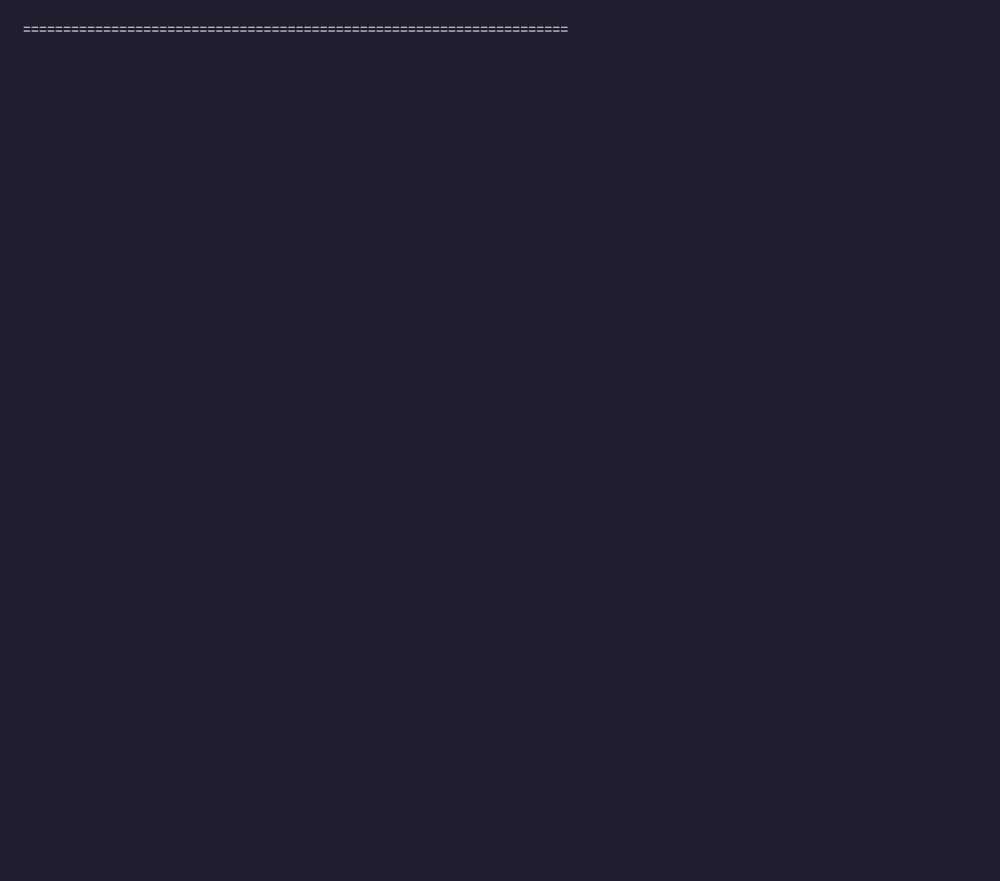

# Data Shell — Enterprise Perimeter Gateway

[]()
[]()
[]()
[]()
[](./LICENSE)
[](https://render.com/deploy?repo=https://github.com/Pulkit-Handa/data_shell)

> **"Bad data never lands, and never leaves."**

**Data Shell** is a contract-driven perimeter gateway that enforces data quality *at the boundary* — checking partner/vendor feeds before they land in internal systems (inbound), and validating regulatory/partner submissions before they are filed (outbound).

It is a **write gate, not a report**. Rejected records are never published. A four-stage pipeline casts and validates every record, a zero-deficit reconciliation gate refuses to publish unless every input row is accounted for, and a successful delivery is committed atomically and bound to a signed, independently verifiable certificate. Every terminal outcome is written to a durable forensic ledger.

The reference deployment is deliberately **single-replica**: the credential registry and rate limiter are process-local. See [Release-readiness status](#release-readiness-status) before promoting a deployment.

## Why not Great Expectations?

The 30-second answer: Great Expectations tells you what is wrong with your data;
**Data Shell refuses to publish bad data and proves, cryptographically, that what
it delivered is exactly what it validated**.

1. **Enforcement, not observation.** GX executes expectations and hands back a
   validation report; the decision to quarantine, substitute, or publish — and the
   guarantee that every input row is accounted for — remains your code. Here that
   is the engine: held/refused/dead row accounting, a zero-deficit reconciliation
   gate that refuses the whole run when a single row is unaccounted for, and
   atomic, sequenced delivery.
2. **Tamper evidence, not trust.** GX reports are not signed. Every delivery here
   is bound to a Merkle-rooted certificate signed with Ed25519 (third-party
   verifiable from a public key) or HMAC-SHA256, plus a durable forensic ledger;
   `datashell verify` detects a single flipped byte in the delivered Parquet
   after the fact — and proves it — in the 60-second walkthrough below.
3. **The boundary ships as a system.** GX is a library you wire into a pipeline
   program you also have to build, secure, and audit. Data Shell ships that
   pipeline side as an API gateway: key-based roles and capabilities, upload
   size/format refusals, Prometheus metrics, a signed run ledger, and a
   production console — with the same engine available as a library
   (`DataShellPipeline`) and pluggable rule checks.
4. **Honest trade-off.** GX has a far larger expectation ecosystem, profiling,
   data documentation, and a bigger community. If you are building an internal
   data-catalog/observability stack, GX is a reasonable choice — this project is
   not trying to replace that breadth. Data Shell is for a **controlled perimeter
   with inputs you have reason not to trust**, where refusal semantics and
   auditability matter more than expectation breadth. The reference deployment is
   intentionally single-replica and self-contained; scale-out moves the same
   engine onto shared infrastructure (see `docs/SCALING.md`).

---

## Try it in 60 seconds



```bash
pip install datashell          # core enforcement engine (polars + pyarrow only)
pip install "datashell[all]"   # + HTTP gateway, DuckDB batch rules, billing adapter
datashell doctor               # report which capabilities the environment has
datashell demo                 # refuse poisoned rows, publish clean ones, detect tampering
```

`datashell demo` is a self-contained walkthrough: it generates a 1,000-row feed with
100 seeded defects, enforces a contract, then flips a byte in the delivered Parquet
and proves the signed certificate detects it — and that restoring the bytes restores
the verdict:

```text
[3a] Held rows by rule:
      - amount-positive     :   35 held
      - currency-settled    :   25 held
[3b] Structural refusals at ingestion:
      - amount:Float64      :   20 refused
      - settlement_id:Utf8  :   20 refused

[4] Verify the signed certificate -> AUTHENTIC_AND_UNMODIFIED
[5] Tamper the delivered parquet (1 byte) and re-verify -> TAMPERED_UNDERLYING_ARTIFACTS
[6] Restore the authentic bytes and re-verify           -> AUTHENTIC_AND_UNMODIFIED
```

The full walkthrough also runs from `./examples/quickstart.sh`. To regenerate the GIF,
either run `vhs examples/demo.tape` (requires [VHS](https://github.com/charmbracelet/vhs))
or, without a terminal recorder, run `./examples/render_demo_gif.sh` (uses ImageMagick).

---

## Enterprise System Architecture

```
                 [ External Partner Feed / Regulatory Return ]
                                        │
                                        ▼ (HTTPS / TLS)
    ┌────────────────────────────────────────────────────────────────────────┐
    │                 DATA SHELL ENTERPRISE GATEWAY                       │
    │                                                                        │
    │  [ RBAC & API Key Auth ] ──► [ Token-Bucket Rate Limiter ]             │
    │                                                                        │
    │  ┌──────────────────────────────────────────────────────────────────┐  │
    │  │ Tier 1: At the Door (Structural Gate)                            │  │
    │  │ • Strict schema casting & type realization                       │  │
    │  │ • Ejects unrealizable records into Structural Rejection Ledger   │  │
    │  └─────────────────────────────────┬────────────────────────────────┘  │
    │                                    │ (Conforming Records)              │
    │                                    ▼                                   │
    │  ┌──────────────────────────────────────────────────────────────────┐  │
    │  │ Tier 2: Inside (Semantic Gate)                                   │  │
    │  │ • Vectorized Row Rules (Polars columnar)                         │  │
    │  │ • DuckDB batch rules + out-of-core streaming                     │  │
    │  │ • Rolling per-tenant drift baselines from the boundary ledger    │  │
    │  └─────────────────────────────────┬────────────────────────────────┘  │
    │                                    │                                   │
    │                                    ▼                                   │
    │  ┌──────────────────────────────────────────────────────────────────┐  │
    │  │ Tier 3: Zero-Deficit Reconciliation ("The arithmetic has to foot")│  │
    │  │ • Rows Read = Refused + Held + Delivered                         │  │
    │  │ • Refuses to publish on any mismatch                             │  │
    │  └─────────────────────────────────┬────────────────────────────────┘  │
    │                                    │                                   │
    │                                    ▼                                   │
    │  ┌──────────────────────────────────────────────────────────────────┐  │
    │  │ Tier 4: Crash-recoverable Atomic Publish                         │  │
    │  │ • Staged target + immutable lineage artifact + certificate       │  │
    │  │ • Write-ahead journal, recovered at startup                       │  │
    │  └─────────────────────────────────┬────────────────────────────────┘  │
    │                                    │                                   │
    │  ┌──────────────────────────────┐  │  ┌─────────────────────────────┐   │
    │  │ Boundary Ledger (durable)    │◄─┴─►│ Signed Audit Certificate    │   │
    │  │ • run history & quarantine   │     │ • SHA-256 + Merkle root     │   │
    │  │ • usage metering & baselines │     │ • HMAC-SHA256 envelope      │   │
    │  └───────────────┬──────────────┘     └─────────────────────────────┘   │
    │                  │                                                      │
    │        [ Prometheus /metrics ]   [ signed run.completed webhook ]       │
    └────────────────────────────────────┬───────────────────────────────────┘
                                         ▼
                    [ Tenant-Isolated Curated Storage (output/tenants/...) ]
```

---

## Capabilities

### 1. Refusal-first write gate
Four sequential stages, each of which can stop a run before anything is published:

* **Tier 1 — structural gate:** strict, per-row schema casting. Records that cannot be realized are refused and indexed, never coerced silently.
* **Tier 2 — semantic gate:** vectorized row rules (Polars) plus batch rules (DuckDB, and out-of-core in streaming mode). A fast vectorized path is used only when a chunk already matches the declared schema; otherwise rows are validated one by one, preserving strict Tier-1 semantics.
* **Tier 3 — reconciliation gate:** the arithmetic has to foot (`read = refused + held + delivered`). A mismatch refuses the run instead of publishing a partial dataset.
* **Tier 4 — atomic publish:** the active target, an immutable lineage artifact, and the signed certificate are committed through a write-ahead journal and recovered at startup. Quarantine artifacts survive rejection so evidence is never lost.

### 2. Cryptographically verifiable certificates
Every run emits a certificate bound to the exact contract, source payload bytes, delivered
bytes, and each quarantine artifact (by hash *and* path). The source digest is real in every
mode: file-backed runs hash the source on disk, and in-memory runs hash the canonical record
set. Verification recomputes every hash and the Merkle root and confirms the signature
envelope against trusted key IDs. Certificates are signed with **Ed25519** when
`DATASHELL_ED25519_PRIVATE_KEY` is provisioned — so a third party holding only the published
public key can verify them without a shared secret — and fall back to HMAC-SHA256 otherwise.
Certificates state which mode was used (`third_party_verifiable`, `requires_shared_secret`).
Verify from the CLI or the API:

```bash
datashell verify output/audit/<run_id>_audit_certificate.json
# or
curl -H "X-API-Key: $KEY" https://gateway/api/v1/runs/<run_id>/certificate
```

### 2b. Feed controls and drift metrics
Contracts express the checks real external feeds need, evaluated over the **delivered** rows
only (held/quarantine rows never satisfy a control or mask a duplicate):

* **Unique and composite keys:** `UNIQUE` (one column) and `COMPOSITE_UNIQUE` (`columns`).
* **Batch control totals:** `SUM_EQUALS` (with optional `tolerance`) and `SUM_BETWEEN`.
* **Parser options:** CSV delimiter, quote character, header presence, encoding, and null
  tokens (`sources[].parser`).
* **Schema compatibility:** `STRICT` refuses rows that omit a declared column; `EVOLVING`
  (default) back-fills nullable columns.

Every execution mode extracts per-feed metrics — null rate per column plus sum/mean for
numerics — persists them in the boundary ledger, and can compare them run-over-run so a
feed that silently shifts is caught. Historical drift is **opt-in**
(`DRIFT_ENABLED=false` by default) so a small test run can never become the baseline
that rejects a production delivery; enable it once a feed has stable history. Metric
drift is gated by configurable thresholds and a minimum baseline history, so normal
variation during initial learning never blocks a feed. `--no-drift` bypasses drift for
one run, and `DRIFT_BASELINE_RESET=true` re-baselines once without deleting ledger
history.

### 3. Durable boundary ledger
The ledger is a tenant-isolated, append-only forensic record of **every** terminal run —
including rejections and failures — with a quarantine index and per-run usage metering.
It powers rolling drift baselines, incident forensics, and outcome-as-a-service billing.

```bash
datashell ledger summary                 # delivery health for a tenant
datashell ledger runs --status REJECTED  # what was refused, newest first
datashell ledger show <run_id>           # one full forensic record
datashell ledger quarantine --reason amount
datashell ledger usage --since 2026-01-01T00:00:00Z
datashell ledger trend                   # chronological volume
```

The same data is available over HTTP (`/api/v1/runs`, `/api/v1/runs/summary`,
`/api/v1/quarantine`, `/api/v1/usage`), always tenant-scoped. Set
`DATASHELL_HISTORY_RETENTION_DAYS` to bound retention; retention is enforced at startup.

When `DATASHELL_RUN_WEBHOOK_URL` is set, each terminal run is pushed to your
runbook/SIEM endpoint as a signed `run.completed` event (HMAC-SHA256 over
`timestamp.body`, with bounded retries). Emission is best-effort and can never fail a run.

### 4. Multi-tenant RBAC & physical isolation
Four roles (`ADMIN`, `DATA_ENGINEER`, `PRODUCER`, `AUDITOR`) and six capabilities.
Delivery roots are partitioned under `output/tenants/<tenant_id>/`; cross-tenant
delivery attempts, cross-tenant certificate reads, and production temporary-directory
writes are rejected with an explicit denial.

### 5. Bounded memory and disk at scale
The out-of-core streaming engine (`run_streaming`) streams Parquet, CSV, and
JSONL/NDJSON in configurable micro-batches so application memory stays bounded by the
batch size, not the file size. The **built-in upload ceiling is 20 GiB**, and the
request-body limit derives from it automatically. A run preflights free space and
refuses to start (rather than failing mid-run) when the storage volume cannot hold its
transient footprint. `STREAM_AUTO_THRESHOLD_BYTES` (default 64 MiB) selects streaming
automatically for large sources, and upload spill uses the durable `TMPDIR`/
`DATASHELL_TMP_DIR`.

### 6. Observability
Real-time telemetry at `/metrics`: `datashell_rows_read_total`,
`datashell_rows_delivered_total`, `datashell_rows_held_total`,
`datashell_footing_errors_total`, and a run-duration histogram. Tenant, contract, and
rule IDs are excluded from metric labels to avoid cardinality blow-up and data leakage.

### 7. Orchestration integrations
A local CLI (`datashell run|validate-contract|verify|ledger|demo|contract|settlement`) and an
Apache Airflow provider (`integrations/airflow`) with `DataShellEnforceOperator` (gateway API)
and `DataShellLocalEnforceOperator` (CLI, for multi-gigabyte inputs on the worker).

### 8. Verifiable commercial settlement
Turn a verified delivery run into a contractual obligation without a spreadsheet and without
moving money. A versioned **commercial contract** (pricing, qualification, acceptance,
penalties) is bound by SHA-256 digest; the deterministic engine consumes verified run
evidence and produces an exact minor-unit **settlement statement** with machine-readable
reason codes. A **signed settlement receipt** binds the delivery certificate digest, the
exact contract version, and every calculated field — tamper with any of them and
verification fails. Failed reconciliation or an invalid certificate can never authorize a
payable amount. Disputes block automatic billing and preserve the original evidence.

```bash
datashell contract create examples/commercial_delivery_contract.json --tenant acme
datashell settlement calculate --run-id dm_run_… --contract-id ctr_vendor_settlements_usd \
    --tenant acme --idempotency-key invoice-2026-10
datashell settlement explain stl_…  --tenant acme   # the arithmetic, step by step
datashell settlement verify  stl_…  --tenant acme   # signed evidence
python examples/settlement_demo.py                   # 1M rows → USD 49,250.00 derived, scenarios A–H
```

Billing providers are an abstraction: the default **dry-run** adapter is offline and
deterministic; an opt-in **Stripe** adapter creates *draft* invoices only
(`auto_advance=false`), records a timeout as `UNRESOLVED` rather than "not created", and
refuses blind retries. Read more in
[docs/SETTLEMENT.md](docs/SETTLEMENT.md) and
[docs/SETTLEMENT_OPERATIONS.md](docs/SETTLEMENT_OPERATIONS.md).

---

## Local Quickstart

### 1. Run the test suite
```bash
pip install --require-hashes -r requirements-dev.lock   # hash-pinned dependency set
pip install -e .                                        # the package itself
pytest -q                                               # 466 tests in tests/, plus 9 Airflow provider tests
```
The lockfiles are the reproducible dependency sets used by CI and the container images.
Regenerate them on the lowest supported interpreter (3.11), not the developer's.

### 2. See the boundary do its job
```bash
datashell demo                            # refusal -> tamper -> verify
datashell validate-contract -c examples/vendor_settlements_contract.json
```

### 3. Enforce a contract against your own file
```bash
datashell run \
  --contract examples/vendor_settlements_contract.json \
  --source   /mnt/landing/settlements.jsonl \
  --target   ./output/curated/settlements.parquet \
  --audit    ./output/audit/settlements_certificate.json
# exit code 0 = delivered, 2 = rejected by policy, 1 = engine failure
```

### 4. Launch the gateway
```bash
uvicorn datashell.server.app:app --host 0.0.0.0 --port 8000
```
Open `http://localhost:8000` for the control console. Interactive API docs are disabled
in production.

---

## Deploy

* **Docker Compose:** `docker compose up --build` (persistent volume, non-root container).
* **Render (demo UI):** click **New + → Blueprint** and select the repository;
  `render.yaml` serves the landing page + interactive playground on the free plan.
* **Render (gateway):** `render-api.yaml` is the hardened API blueprint (120 GB disk,
  20 GiB upload defaults). Render only auto-detects `render.yaml`, so copy
  `render-api.yaml` over `render.yaml` in your fork to deploy the gateway.
* **Kubernetes:** apply `k8s-deployment.yaml` (120 GiB `ReadWriteOnce` PVC, one replica).

---

## Release-readiness status

This repository does **not** claim third-party production certification. A deployment
should not be promoted until CI passes in a clean environment, the deployment-specific
threat model and load tests are reviewed, backup/restore and disaster recovery are
exercised, and external identity / rate-limit / audit-persistence requirements are
satisfied. The credential registry is a local SQLite file and the token-bucket rate
limiter is process-local; **run one replica and one worker**, and move both to shared
infrastructure before scaling horizontally.

Production startup requires explicit `DATASHELL_API_KEY`, `DATASHELL_HMAC_SECRET`, and an
exact HTTPS `ALLOWED_ORIGINS` allowlist. To sign audit certificates asymmetrically (so
third parties can verify with a public key only), set `DATASHELL_ED25519_PRIVATE_KEY` and
publish the derived public key; retain previous key IDs in `DATASHELL_ED25519_KEYRING`
during rotation. Configure `FORWARDED_ALLOW_IPS` with explicit
trusted proxy IPs/CIDRs (never `*`), plus `MAX_UPLOAD_SIZE_BYTES`,
`MAX_REQUEST_BODY_BYTES`, `MAX_CONTROL_BODY_BYTES`, `MAX_CONCURRENT_REQUESTS`,
`MAX_CONCURRENT_RUNS`, `DUCKDB_MEMORY_LIMIT`, and `MIN_FREE_DISK_BYTES` for your
deployment and resource budget. For large-file workloads, also set
`STREAM_AUTO_THRESHOLD_BYTES` and `STREAM_CHUNK_ROWS`, and point
`TMPDIR`/`DATASHELL_TMP_DIR` at the durable storage volume. See
`docs/production/OPERATIONS_RUNBOOK.md` for the operational runbook and
`docs/THREAT_MODEL.md` for the trust boundaries.

---

## Volumetric benchmark

The repository ships a benchmark harness but no stored results; do not use invented
figures for capacity planning. Measure on your own hardware:

```bash
python benchmarks/volumetric_stress_test.py   # row throughput up to 1,000,000 rows
python benchmarks/api_latency_load_test.py     # gateway request latency under load
# or the built-in measurement (no repository checkout required):
datashell benchmark --rows 1000000             # synthetic feed, JSON with --json
```

The harnesses assert expected delivered counts and inspect the resulting files, so a
"fast" run that silently drops rows fails rather than reporting a flattering number.
Separately, the out-of-core streaming path has been exercised end-to-end on a
20-million-row CSV with a peak RSS of roughly 369 MB, confirming that application
memory stays bounded by the streaming batch size rather than the input size.

---

## Documentation

* `docs/FIRST_RUN.md` — a five-minute guided first run using the sample dataset.
* `docs/EVALUATION.md` — the adoption path: quickstart, integration patterns, a controlled-pilot checklist, and known limitations.
* `docs/production/RELEASE_CHECKLIST.md` — pilot release gates, acceptance evidence, and remaining blockers.
* `docs/production/OPERATIONS_RUNBOOK.md` — runbook: startup, health checks, backup/restore, monitoring, rollback.
* `docs/production/CONFIGURATION_REFERENCE.md` — every environment variable, CLI option, API endpoint, role, and certificate field.
* `docs/SCALING.md` — the five scaling surfaces (ingest backend, batch size, SQL threads, delivery codec, concurrency/disk) and worked deployment profiles.
* `docs/SDK.md` — regenerated Python/TypeScript clients, the pinned OpenAPI Generator workflow, and the client versioning truth table.
* `docs/THREAT_MODEL.md` — assets, trust boundaries, and mitigations.
* `docs/SETTLEMENT.md` — settlement architecture, schemas, acceptance/pricing semantics, invariants, and limitations.
* `docs/SETTLEMENT_OPERATIONS.md` — settlement CLI/API reference, billing configuration, disputes, threat model, and production checklist.
* `docs/archive/PRODUCT_VALIDATION.md` — prior product-validation findings (historical reference).

---

## License

Licensed under the [Apache License, Version 2.0](./LICENSE).
